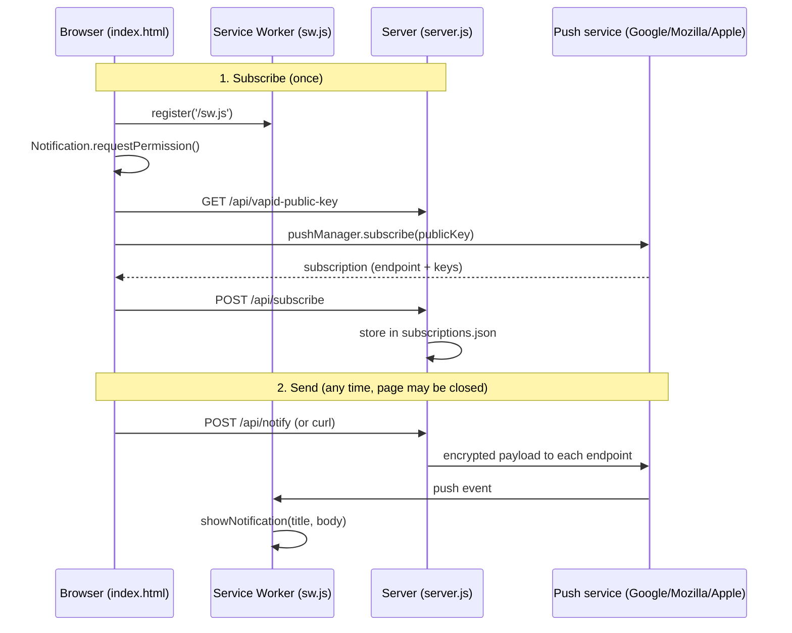

# web-push-example

Minimal Web Push demo: Node.js + Hono on the server, a single static HTML page and a service worker in the browser. 

## Run

```bash
npm install
npm start   # http://localhost:3000
```

Open the page, click **Enable notifications**, then **Send test push**.

## How it works



1. **Keys:** On first start the server generates a VAPID key pair (`vapid.json`). It identifies the server to the push services. Keep it stable, because subscriptions are bound to it.
2. **Subscribe:** The page registers the service worker, asks for permission (must happen on a click, iOS requires that), and subscribes via the browser's push service using the server's public key. The resulting subscription (a unique endpoint URL plus encryption keys) is sent to the server and stored.
3. **Send:** `POST /api/notify` makes the server encrypt the message and send it to every stored endpoint. The push service delivers it to the device, where the service worker wakes up and shows the notification. No open tab is needed, only a running browser.
4. **Cleanup:** If a push service answers 404/410, the subscription has expired and is removed.
5. **Click:** Clicking the notification focuses an open tab or opens `/`.

## API

| Endpoint | Description |
| --- | --- |
| `GET /api/vapid-public-key` | `{ publicKey }` |
| `POST /api/subscribe` | Body: subscription JSON. Duplicates (same `endpoint`) are ignored. |
| `POST /api/notify` | Body: `{ title, body }` (optional). Returns `{ sent, removed }`. |

Trigger a push without the page:

```bash
curl -X POST localhost:3000/api/notify -H 'Content-Type: application/json' -d '{"title":"Hello","body":"Push without an open page"}'
```

## Notes

- **HTTPS required:** Push only works in a secure context (HTTPS or `localhost`). To test on a phone, use a tunnel, e.g. `cloudflared tunnel --url http://localhost:3000`.
- **iOS (16.4+):** Open the page in Safari, *Share → Add to Home Screen*, and subscribe from the installed app (needs `manifest.json` with `display: "standalone"`).
- **Local network:** Over plain `http://<lan-ip>:3000` a device can't subscribe, but it can still trigger pushes with **Send test push**. On Windows, allow port 3000 in the firewall.
- **No auth:** Anyone who can reach `/api/notify` can send pushes. Fine for a demo, not for production.
